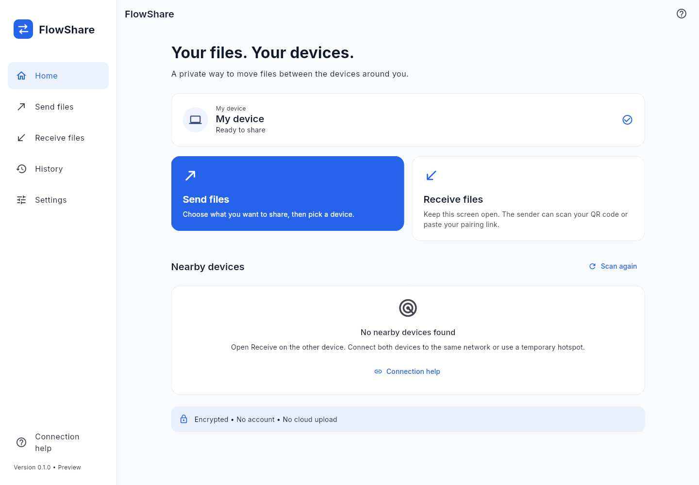

# FlowShare

Private, offline file sharing across Android, iOS, Windows and macOS over a local network or hotspot.

[](https://github.com/mizanurofcl55-hue/FLOW-SHARE/actions/workflows/ci.yml)
[](https://github.com/mizanurofcl55-hue/FLOW-SHARE/actions/workflows/android-smoke.yml)

**[Download the preview](https://github.com/mizanurofcl55-hue/FLOW-SHARE/releases/tag/v0.1.0-preview.1)** · [Installation guide](docs/downloads.md) · [Report a problem](https://github.com/mizanurofcl55-hue/FLOW-SHARE/issues)

**0.1.0 preview.** Real encrypted local-network file transfers are implemented. This is not a production-release claim: physical-device interoperability, store signing, and the direct Nearby / Wi-Fi Aware / Apple peer-to-peer adapters are not yet verified or included. The [development report](docs/development-report.md) separates implementation, automated evidence, and remaining work.



## Verified preview build

The public release workflow requires successful Android, iOS, Windows and macOS builds, 14 core tests, 9 Flutter tests, static analysis and the Android installed-APK test before publishing downloads. The release contains SHA-256 checksums and `build-provenance.json` with links to the exact public build and emulator runs. [View public builds](https://github.com/mizanurofcl55-hue/FLOW-SHARE/actions).

The Android emulator test covers startup, navigation, a native receive listener and QR invitation, stopping the listener and restart. Physical cross-device transfers remain unverified. Earlier development-run evidence is preserved under [docs/evidence](docs/evidence); its old hashes belong to the original private-repository builds, not the new public downloads.

## Downloads

| Platform | Preview availability |
|---|---|
| Android | Installable debug APKs: **ARM64** for most phones, ARMv7 for older phones, x86_64 for emulators |
| Windows | Portable x64 ZIP; extract the entire folder before running `flowshare.exe` |
| macOS | Unsigned debug app bundle for developers; signing/notarization pending |
| iOS | Unsigned developer `.app`; **not an installable IPA**, Xcode/provisioning required |

Download from **[Releases](https://github.com/mizanurofcl55-hue/FLOW-SHARE/releases/tag/v0.1.0-preview.1)** without a GitHub account. Source is available via **Code → Download ZIP**. See the [download and installation guide](docs/downloads.md) for checksums and preview upgrade limitations.

**বাংলা:** সাধারণ Android ফোনের জন্য release-এর **arm64 APK** নিন। দুই ডিভাইস একই Wi-Fi অথবা একটির hotspot-এ যুক্ত করে Send/Receive ব্যবহার করুন। Internet বা account লাগে না। QR নিজে Wi-Fi কানেক্ট করে না। এটি পরীক্ষামূলক সংস্করণ; বাস্তব দুই ডিভাইসে transfer যাচাই ও production signing এখনো বাকি।

## Use it

1. Connect both devices to the same Wi-Fi, Ethernet LAN, or temporary hotspot. An internet connection is not required for local transfer.
2. Open **Receive files → Start receiving** on the recipient.
3. On the sender, choose files, scan for the receiving device, or paste/scan its pairing link.
4. Compare **all four verification-code groups** on both devices and approve on both.
5. Keep the apps open until both report completion. Received bytes are SHA-256 verified before final commit.

For router-free setup on supported Android devices, open **Connection help → Create local hotspot**, join its displayed network from the second device, then start receiving and refresh addresses. Other platforms offer system hotspot guidance. QR codes carry identity and address information; they do not establish a Wi-Fi connection. Camera scanning runs locally on Android/iOS; Windows/macOS use discovery or paste the pairing link.

## Included

- Streaming TLS, pinned receiver certificate, signed sender identity, explicit approvals, bounded framing, cancellation, checksum verification, and safe destination names.
- Retry from verified completed-file boundaries; interrupted files restart from zero. No unsafe reuse of partial data.
- Real mDNS discovery, manual/QR pairing, Android local-only hotspot, and an Android active-transfer service.
- Native file selection, desktop drag and drop, file opening, SQLite history and remembered identities, OS-protected private keys.
- English/Bengali, light/dark/system themes, mobile navigation and desktop sidebar, onboarding, permission explanations, and recovery guidance.
- Native build workflows, locked Dart dependencies, original branding, bundled font licenses, and a documented compatibility matrix.

## Development

Use **Flutter 3.47.7** (also pinned in `.fvmrc`). Flutter embeds the required Dart SDK.

```sh
cd packages/transfer_core
dart pub get --enforce-lockfile
dart analyze --fatal-infos
dart test
cd ../../apps/flutter_app
flutter pub get --enforce-lockfile
flutter analyze --no-pub
flutter test --no-pub
flutter run
```

Native builds require the matching OS/toolchain: Android SDK + JDK 17, Xcode on macOS for Apple builds, and Visual Studio C++ tools on Windows. CI builds these targets on their native runners. No backend, API key, or cloud account is required to run FlowShare.

```sh
flutter build apk --debug --split-per-abi
flutter build windows --release
flutter build macos --debug
flutter build ios --debug --no-codesign
```

CI artifacts include SHA-256 checksums. Android APKs are debug-signed previews; Windows is a portable bundle; Apple artifacts are unsigned preview bundles and may require local signing to run. See [release instructions](docs/release.md).

## Repository guide

| Path | Purpose |
|---|---|
| `apps/flutter_app` | App, design system, localization, local persistence, discovery, and native runners |
| `packages/transfer_core` | UI-independent authenticated protocol, bounded I/O, recovery, integration/security tests |
| `docs` | Architecture, protocol, security, test evidence, compatibility, release and limitations |
| `.github/workflows` | Verification and Android/iOS/Windows/macOS builds; optional 1/5 GiB benchmarks |

[Architecture](docs/architecture.md) · [Protocol](docs/protocol.md) · [Security](docs/security.md) · [Testing](docs/testing.md) · [Compatibility](docs/connectivity-matrix.md) · [Limitations](docs/limitations.md)

The project has no third-party artwork. Inter and Noto Sans Bengali are bundled under their included SIL Open Font Licenses. Dependency licenses are available in Settings. No project-wide open-source license has been selected by the owner.
